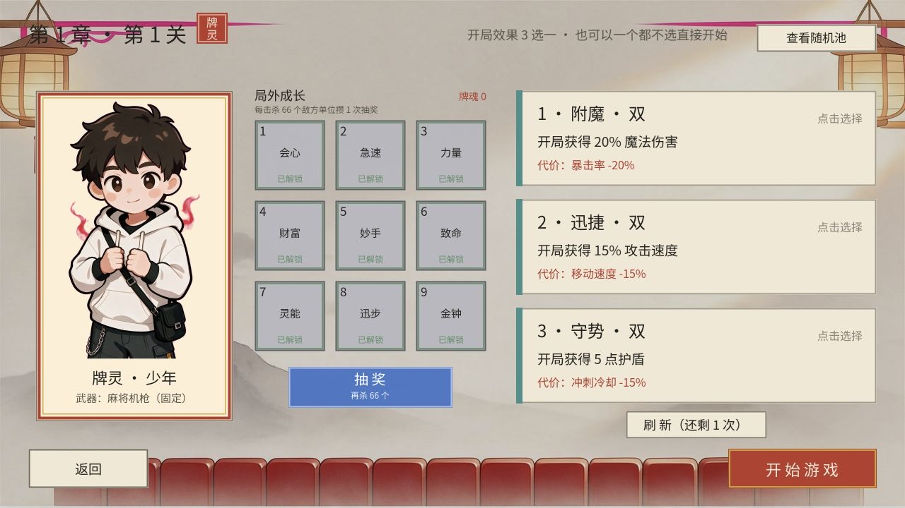
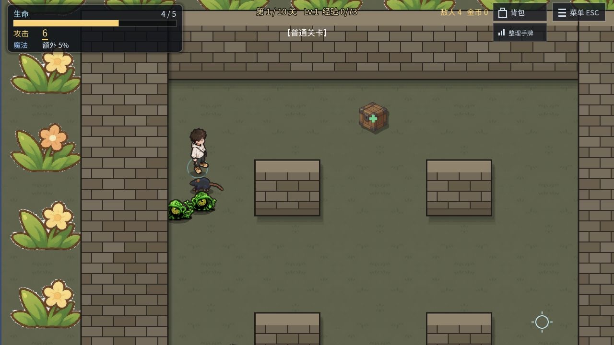
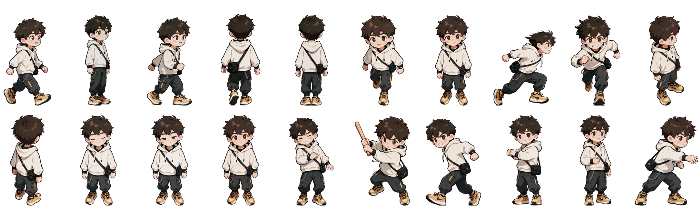
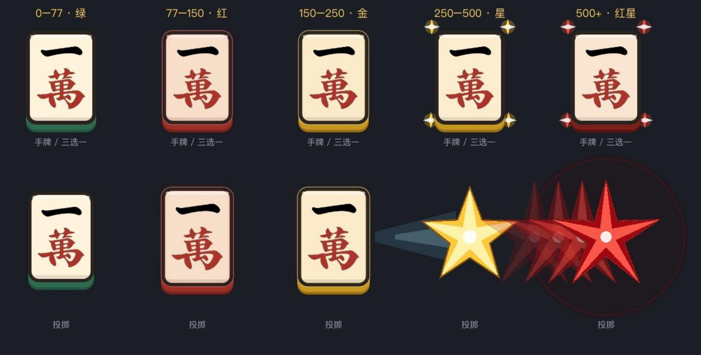
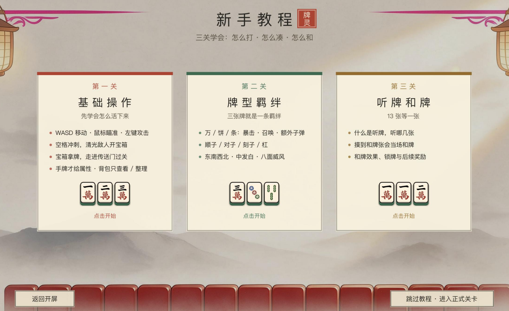
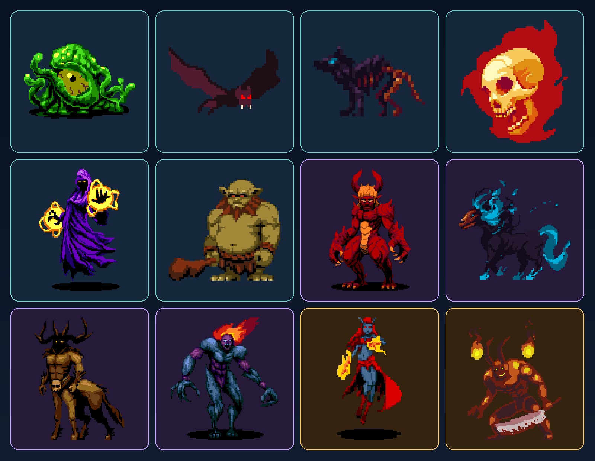
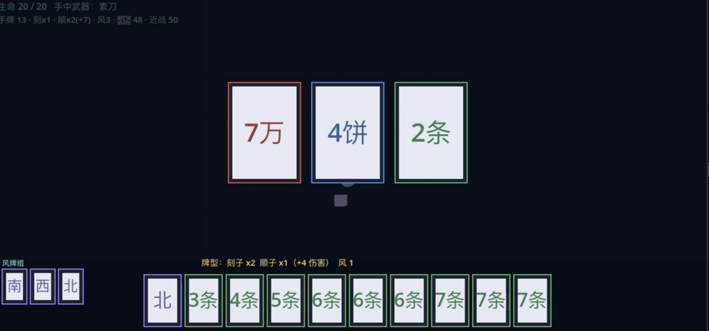

# RPG游戏-麻将牌灵

<p align="center">
  <strong>麻将构筑 × 实时动作 Roguelite</strong><br>
  从空手开局，到组成 13 张听牌、14 张和牌，再把牌型变成战场上真正生效的力量。
</p>

<p align="center">
  <a href="https://zsrzzx.github.io/tile-spirit/">
    
  </a>
  
  
  
</p>

<p align="center">
  <a href="https://zsrzzx.github.io/tile-spirit/"><strong>▶ 现在开玩</strong></a>
  ·
  <a href="https://github.com/ZSRZZX/tile-spirit/issues">反馈问题</a>
</p>

<p align="center">
  
</p>

> **《RPG游戏-麻将牌灵》是一款把麻将构筑与实时动作战斗结合起来的 2D 俯视角 Roguelite。**
> 麻将在本作里不是换皮卡牌，而是你的攻击、羁绊、成长路线和连招核心。

> [!IMPORTANT]
> 本仓库托管的是 **v0.13 HTML5 可玩构建**，不包含项目源码。推荐使用桌面版 Chrome 或 Edge 游玩，暂不支持移动端。

---

## 为什么值得玩

- **麻将真的参与战斗。** 万、饼、条与字牌会改变攻击、召唤、护盾和特殊效果，牌型与羁绊会直接重塑战斗手感。
- **拿牌来自你的选择。** 空手进入关卡，通过升级、宝箱、任务与商人的三选一 / 四选一逐步构筑手牌；手牌满后还能进入背包继续经营。
- **凑牌不是等待随机发牌。** 围绕顺子、对子、刻子、杠与字牌羁绊调整牌组，13 张听牌拿奖励，14 张和牌触发永久强化。
- **动作与构筑同时在线。** 走位、冲刺、近战挥砍、远程投掷和武器切换都要自己操作，麻将牌则是你越打越强的底层引擎。
- **短局循环，持续变强。** 每关 10 个回合，第 5 回合迎战小 Boss，第 10 回合迎战大 Boss，再带着牌魂进入下一轮。

---

## 核心循环

```text
选择角色与开局祝福
        ↓
空手进入实时关卡，边战斗边升级
        ↓
升级 / 开宝箱 / 完成任务 → 三选一或四选一拿牌
        ↓
经营 13 张手牌与背包 → 激活牌型羁绊、进入听牌
        ↓
组成 14 张和牌 → 获得永久强化
        ↓
选择下一节点 → 第 5 回合小 Boss → 第 10 回合大 Boss
        ↓
结算、局外成长、下一轮构筑
```

### 构筑与战斗

| 系统 | 作用 |
| --- | --- |
| 麻将牌池 | 34 种牌、每种 4 张，共 136 张；保留真实的牌张数量限制 |
| 拿牌 | 通过升级、宝箱、任务与商人获得；每次从多个候选中选择，手牌满后进入背包 |
| 牌型羁绊 | 顺子、对子、刻子、杠与字牌组合会提供额外的战斗能力 |
| 听牌 | 手牌接近和牌时进入听牌状态，并获得对应奖励 |
| 和牌 | 组成有效和牌型后触发强化，让整套构筑进入更强的形态 |
| 副露与下蛋 | 杠、风牌或箭牌可以放到副露区，继续触发额外组合与奖励 |
| 动作战斗 | 实时走位、冲刺、近战与远程切换，牌组强化直接反映到攻击和生存能力上 |
| 局外成长 | 完成挑战积累牌魂，解锁下一轮的开局优势 |

---

## 画面

<table>
  <tr>
    <td width="50%">
      
    </td>
    <td width="50%">
      
    </td>
  </tr>
  <tr>
    <td align="center"><sub>选择角色、武器与开局祝福</sub></td>
    <td align="center"><sub>一边走位一边把麻将打成火力</sub></td>
  </tr>
</table>

---

## 美术与动作

### 主角：移动、冲刺与投掷的关键动作帧

<p align="center">
  
</p>

主角按正面、背面与侧面整理了站立、走路、冲刺、攻击和投掷姿态。走路使用「跨步 → 并拢」的多帧组合，冲刺、攻击起手与收招、投掷与回收使用 2–3 个关键帧配合程序位移、镜像和缓动，让动作保持利落，也让小尺寸画面中的轮廓足够清楚。

### 牌面等级与局内特效

<p align="center">
  
</p>

牌面按强化阶段使用绿色、红色、金色、星标与红星等视觉层级。等级越高，牌框、光效和投掷轨迹越醒目；战斗时不需要频繁查看数值，也能从画面判断一张牌的力量。

### 新手教程设计

<p align="center">
  
</p>

新手教程拆成“基础操作、牌型羁绊、听牌和牌”三关，先学会在战场上活下来，再理解三张牌形成的羁绊，最后掌握 13 张听牌与 14 张和牌。

### 敌人设计与 itch.io 致谢

<p align="center">
  
</p>

敌人详情参考了 **itch.io** 上多位独立创作者公开分享的像素作品、角色设定与视觉表达。感谢这些创作者的无私分享——这些前辈留下的灵感、素材展示和制作经验，让敌人的轮廓、配色和辨识度能够更快成型。

> 本页仅作设计过程记录与作者致谢；实际素材与角色设计的授权、署名要求，以对应原作者的发布页面为准。

### 早期原型记录

<p align="center">
  
</p>

从最初的 13 张手牌与三选一试玩，到现在的实时关卡、升级拿牌、背包、副露与和牌系统，核心一直没变：让麻将的“组牌”真正改变动作战斗。

---

## 操作

| 按键 | 动作 |
| --- | --- |
| `WASD` / 方向键 | 移动 |
| 鼠标 | 瞄准 |
| 鼠标左键 | 攻击 / 连续挥砍 / 远程投掷 |
| `J` 或左下角按钮 | 近战与远程武器切换 |
| `空格` / `Shift` | 冲刺（带无敌帧） |
| `Esc` | 暂停菜单 |

> 首次游玩建议先进入「新手教程」：三关分别介绍操作、牌型羁绊、听牌与和牌。

---

## 当前版本

| 项目 | 内容 |
| --- | --- |
| 版本 | `v0.13` |
| 更新日期 | 2026-10-05 |
| 状态 | 可玩原型（Prototype） |
| 引擎 | Godot 4.7 |
| 发布形式 | HTML5 / WebAssembly |
| 托管 | GitHub Pages |
| 内容 | 新手教程、角色构筑、麻将牌组、敌人与 Boss、商人、局外成长 |

### 已包含

- 2D 俯视角实时动作战斗
- 万、饼、条与字牌的牌型、羁绊和等级强化
- 13 张听牌 / 14 张和牌判定
- 多角色、近远程武器与开局祝福
- 宝箱、商人、任务 NPC、副露与背包系统
- 普通、精英、限时与 Boss 关卡
- 章节进度、局外成长与浏览器自动存档

---

## 关于这个仓库

这是《RPG游戏-麻将牌灵》的公开可玩版本，仓库根目录中的静态文件即 GitHub Pages 部署内容。

- **游玩地址：** https://zsrzzx.github.io/tile-spirit/
- **问题反馈：** https://github.com/ZSRZZX/tile-spirit/issues
- **源码状态：** 暂未公开

本仓库未附带开源许可证；游戏名称、美术、音频、玩法内容与构建产物版权归作者所有。

<p align="center">
  <sub>Made with Godot · Designed &amp; developed by ZSRZZX</sub>
</p>
